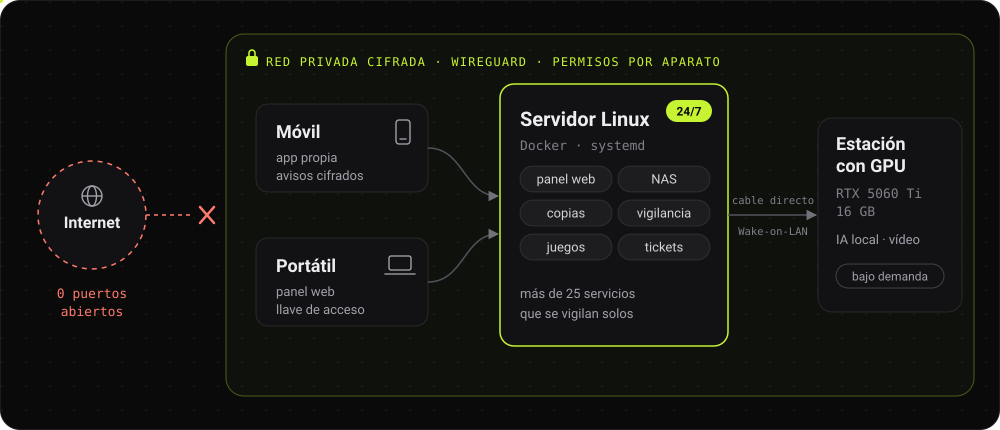

<picture>
  <source media="(prefers-color-scheme: dark)" srcset="assets/cabecera-oscura.svg">
  <source media="(prefers-color-scheme: light)" srcset="assets/cabecera-clara.svg">
  
</picture>

  
  
  

Estudio **2º de DAM** y desde septiembre de 2026 mantengo en marcha mi propio **HomeLab**: un servidor Linux 24/7 con panel web, app Android, IA local, NAS y copias de seguridad que se restauran de verdad.

Lo diseño y lo decido yo, programo con agentes de IA y nada llega a producción sin revisarlo y probarlo. Busco **prácticas de DAM y mi primer puesto junior**, y también monto proyectos para particulares.

| 24/7 | +25 | 0 | 173 |
|:---:|:---:|:---:|:---:|
| en producción desde septiembre de 2026 | servicios vigilados cada 5 minutos | puertos abiertos a Internet | decisiones técnicas escritas con su porqué |

Cifras de noviembre de 2026, sacadas del propio sistema.

## El proyecto principal: un centro de datos en casa

Empezó el 6 de septiembre de 2026 con un portátil modesto (4 núcleos, 9,6 GB de RAM) y una pregunta: ¿cuánto se puede hacer con poco si se hace bien? Hoy es un sistema distribuido con dos máquinas, una red privada cifrada, una app propia y más de 25 servicios que se vigilan solos.

<picture>
  <source media="(prefers-color-scheme: dark)" srcset="assets/arquitectura-oscura.svg">
  <source media="(prefers-color-scheme: light)" srcset="assets/arquitectura-clara.svg">
  
</picture>

| Pieza | Qué hace | Clave |
|---|---|---|
| **Panel de control** | Una sola web para ver y manejar todo: estado, consola, juegos, archivos, IA, consumo eléctrico y tickets. Se entra con llave de acceso, sin contraseñas. | Flask · gunicorn · WebAuthn · PWA |
| **App Android** | El panel en el bolsillo: avisos cifrados de extremo a extremo y lo peligroso, firmado con la huella. Se empareja con un QR. | Kotlin · Jetpack Compose |
| **IA local** | Modelos de hasta 35B en la GPU, búsqueda sobre la documentación propia, voz sin Internet y un agente que ejecuta código en una caja sin red. | Ollama · RAG · MCP |
| **NAS** | Si una subida se corta, sigue desde el byte exacto. Se copia a otra máquina por un canal restringido. | subidas reanudables |
| **Copias** | Diaria, externa cifrada y otra fuera de casa. La recuperación está ensayada desde cero. | 3 copias · 1 fuera de casa |
| **Observabilidad** | Métricas, un vigilante cada 5 minutos, consumo eléctrico medido al minuto y avisos que explican qué ha fallado. | métricas · avisos · consumo |
| **Productividad y estudio** | Tareas, calendario sincronizado con Google, finanzas cifradas y tarjetas de repaso espaciado (FSRS) con preguntas que la IA saca de mis apuntes. | FastAPI · PostgreSQL · Alembic |
| **Servidor de juegos** | Minecraft con mods para 8 amigos. Cada mod se revisa sin ejecutarlo antes de instalarlo. | Docker · Forge |
| **Kit del HomeLab** | Todo lo anterior empaquetado para montarlo en otra casa con un asistente, sin datos de la mía. | instalador · en pruebas |

<table>
<tr>
<td width="50%" valign="top">

**Seguridad**

- Nada expuesto a Internet: todo va por una red privada cifrada con permisos por aparato.
- Disco cifrado con LUKS2 que se abre solo con el chip TPM.
- SSH solo con clave, cortafuegos y cada servicio con los mínimos permisos.
- Lo peligroso se firma desde el móvil con una clave del chip seguro y la huella.

</td>
<td width="50%" valign="top">

**Operación**

- Un vigilante lo revisa todo cada 5 minutos y avisa al móvil, cifrado de extremo a extremo.
- Copia diaria, copia externa cifrada y otra en un USB fuera de casa.
- Recuperación ensayada desde cero, sin el servidor.
- Tickets, runbooks, decisiones escritas y un relevo al acabar cada sesión.

</td>
</tr>
</table>

> 🔒 El código del HomeLab es privado porque describe mi casa. En una entrevista lo enseño encantado.

## Cómo trabajo

**Yo decido. La IA programa. Las pruebas mandan.** No escribo cada línea a mano y no lo escondo: dirijo agentes de IA (Claude Code, Codex) como se dirige a un equipo, con reglas, revisión y responsabilidad. Mientras, aprendo los fundamentos en clase y por mi cuenta, para entender todo lo que firmo.

1. **Decido.** Defino el problema, comparo opciones y escribo la decisión con su porqué.
2. **Encargo.** Los agentes trabajan con reglas fijas: nunca usan root, nunca ven secretos y lo que ejecutan en el servidor se ve en una terminal compartida.
3. **Pruebo.** Un «ha salido bien» no prueba nada: miles de pruebas automáticas y una comprobación en vivo tras cada cambio.
4. **Opero y documento.** Los comandos de administrador los reviso y los ejecuto yo. Después: ticket cerrado, documentación al día y relevo escrito.

## Proyectos

<table>
<tr>
<td width="50%" valign="top">

### [inventario-logistica-jdbc](https://github.com/hectoroyogo/inventario-logistica-jdbc)

Inventario y logística en Java con SQL Server: arquitectura por capas, roles, contraseñas con hash y auditoría automática con triggers. Base de datos en Docker.

`Java 17` `JDBC` `T-SQL` `Docker` `Maven`

</td>
<td width="50%" valign="top">

### [gestor-personal](https://github.com/hectoroyogo/gestor-personal)

Gestor personal full-stack: tareas, hábitos, finanzas, notas, agenda y Pomodoro en un solo panel, con autenticación.

`Next.js` `TypeScript` `PostgreSQL` `Prisma`

</td>
</tr>
<tr>
<td width="50%" valign="top">

### Estudio de vídeo automatizado privado

Una fábrica de vídeos cortos: escribe el guion, lo revisa con IA, pone la voz, dibuja o anima, monta con subtítulos y saca la versión en inglés reutilizando las piezas. Con tope de gasto.

`Python` `FFmpeg` `Blender` `MCP`

</td>
<td width="50%" valign="top">

### Radares de tendencias privado

Miran Fortnite, Roblox, YouTube, Google Trends, Wikipedia, Twitch y la prensa, enfrían solos lo que ya pasó y una IA local marca cada mañana lo que merece la pena.

`Python` `APIs` `systemd timers` `Ollama`

</td>
</tr>
</table>

## Stack

  

| Área | Con qué |
|---|---|
| **Sistemas** | Linux (Ubuntu) · systemd · Docker Compose · Tailscale / WireGuard · SSH · UFW · LUKS2 + TPM · Windows · PowerShell |
| **Backend y datos** | Python · Flask · FastAPI · Java 17 · JDBC · SQL Server · PostgreSQL · SQLite · Alembic |
| **Web y móvil** | HTML, CSS y JS sin frameworks · PWA · Kotlin · Jetpack Compose · Next.js · TypeScript |
| **IA** | Ollama · modelos Qwen · RAG con bge-m3 y FTS5 · agentes y MCP · Claude Code · Codex · ComfyUI |
| **Calidad y operación** | pytest · JUnit · Git · Grafana · avisos cifrados · tickets · runbooks |

## Ahora mismo

- Aprendiendo **Linux a fondo, HTTP y REST, Spring Boot y arquitectura de software**.
- Buscando **prácticas de 2º de DAM** y mi primer empleo junior.
- Abierto a proyectos: webs cuidadas, servidores en casa o en la oficina, automatizaciones con IA y paneles a medida. Los detalles, en [hectorob.com](https://www.hectorob.com/#servicios).

<b>In English</b>

 

I'm a second-year **DAM** student (Multiplatform Application Development) in Spain. Since September 2026 I've been running my own **homelab**: a 24/7 Linux server with a web dashboard, an Android app, local AI on a GPU, a NAS and backups that are actually restore-tested, with zero ports open to the Internet.

I design it and make the decisions, I build with AI coding agents under strict rules, and nothing reaches production without review and tests. I'm looking for **DAM internships and a first junior role**.

**Stack:** Linux · systemd · Docker Compose · WireGuard · Python (Flask, FastAPI) · Java 17 · PostgreSQL · SQL Server · Kotlin (Jetpack Compose) · Ollama · RAG · MCP.

More at [hectorob.com](https://www.hectorob.com/), also in English.

---

Diseñado con Claude Code, como mi web · noviembre de 2026

